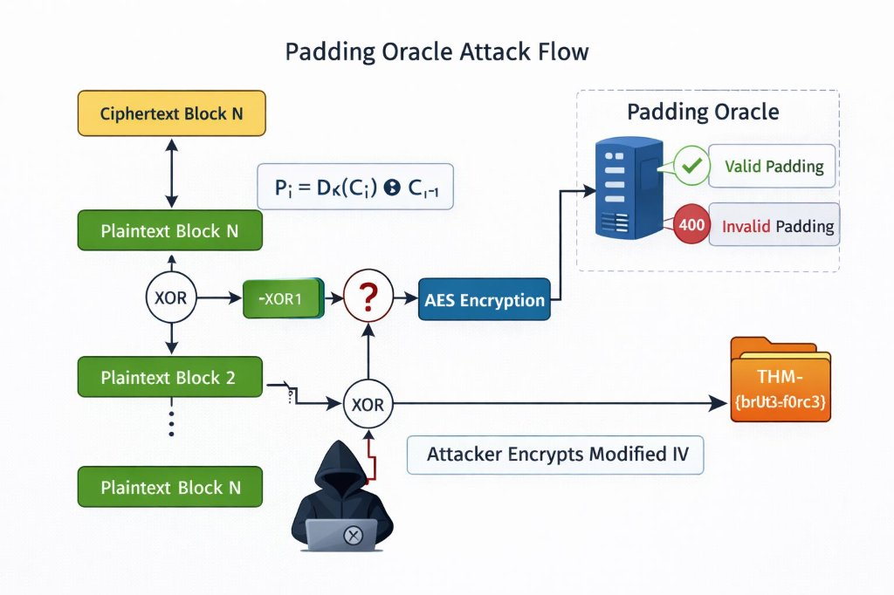

# Padding Oracle Attack Lab

**Cybersecurity Research**  
*Exploiting and Mitigating Padding Oracle Vulnerabilities in CBC-Mode Encryption for Web Applications*

## Overview

This project investigates Padding Oracle Attacks against AES-CBC encrypted web sessions. It demonstrates how distinguishable padding validation responses can allow an attacker to recover plaintext and forge session data without knowing the encryption key.

## Objectives

- Understand AES-CBC and PKCS#7 padding.
- Build a vulnerable web application.
- Demonstrate a Padding Oracle Attack.
- Demonstrate session privilege escalation.
- Implement AES-GCM authenticated encryption.
- Compare vulnerable and secured implementations.

## Architecture

## Technologies

- Python
- Flask (if using Python web framework)
- AES-CBC
- PKCS#7
- AES-GCM
- PyCryptodome or cryptography

## Security Notice

This project is intended for educational and authorized security testing in a controlled local laboratory environment.

## Project Status

In Development
