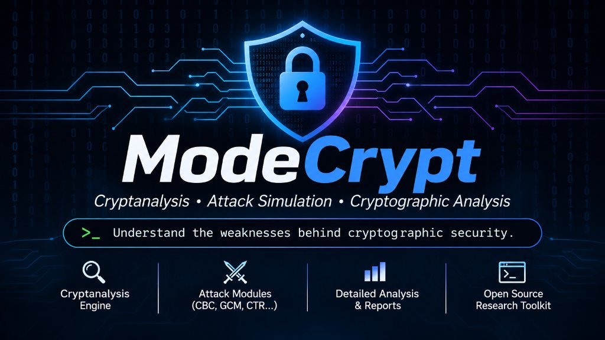

# ModeCrypt
### Cryptanalysis, Cryptographic Analysis & Attack Simulation Toolkit

<p align="center">
  
</p>

<p align="center">
  <strong>A Python-based toolkit for exploring cryptographic algorithms, analyzing ciphertext, and simulating cryptographic attacks.</strong>
</p>

<p align="center">
  
  
  
</p>

---

## About

**ModeCrypt** is a Python-based cryptography research and educational toolkit that combines cryptanalysis, cryptographic analysis, and attack simulation in one platform.

The project aims to help cybersecurity students, developers, penetration testers, and security researchers understand how cryptographic algorithms and encryption modes work, analyze encrypted data, and explore potential weaknesses through controlled experiments.

ModeCrypt focuses on two main components:

- **Cryptanalysis Engine** – analyzes ciphertext, encodings, hashes, and cryptographic characteristics.
- **Cryptographic Attack Engine** – provides controlled simulations and analysis of attacks against different encryption modes.

The project is currently in early development.

## Objectives

- Build a modular cryptanalysis toolkit.
- Analyze ciphertext and identify possible cryptographic characteristics.
- Explore weaknesses in commonly used encryption modes.
- Simulate cryptographic attacks in controlled environments.
- Provide understandable analysis results and reports.
- Support cybersecurity education and cryptographic research.

## Core Features

### 1. Cryptanalysis Engine

The Cryptanalysis Engine focuses on examining encrypted or encoded data and identifying useful characteristics.

| Module | Description |
|---|---|
| Encoding Analysis | Analyze and identify common data encodings. |
| Hash Analysis | Examine hash formats and identify possible hash algorithms. |
| Ciphertext Statistics | Analyze ciphertext characteristics and byte distributions. |
| Block Analysis | Examine block sizes, lengths, and block patterns. |
| Algorithm Analysis | Provide information about supported cryptographic algorithms. |
| Encryption Mode Analysis | Examine characteristics that may indicate encryption modes. |

*Analysis results are candidates and observations, not guaranteed identification of an algorithm or encryption mode.*

### 2. Cryptographic Attack Engine

The Cryptographic Attack Engine focuses on studying potential weaknesses in encryption modes through controlled attack simulations.

| Encryption Mode | Attack / Analysis | Description |
|---|---|---|
| CBC | Padding Oracle Attack | Explore CBC decryption weaknesses when an implementation exposes distinguishable padding-validation responses. |
| GCM | Nonce Reuse Analysis | Examine the security consequences of reusing a nonce with the same key. |
| GCM | Authentication Analysis | Study authentication-tag verification and related security weaknesses. |
| CTR | Keystream Reuse Analysis | Demonstrate the risks of reusing a nonce and counter sequence with the same key. |
| ECB | Repeated-Block Analysis | Examine repeated ciphertext blocks and patterns that can reveal plaintext structure. |
| CFB | Bit-Flipping Analysis | Explore ciphertext malleability and its effects on decrypted plaintext. |
| OFB | Keystream Analysis | Study keystream behavior and the risks associated with IV reuse. |

**Note:** These techniques do not mean every implementation of an encryption mode is vulnerable. Results depend on implementation details, key and nonce management, authentication, and the surrounding application.

## Project Architecture

ModeCrypt is designed with a modular architecture to make individual analysis and attack components easier to develop, test, and maintain.

```text
ModeCrypt/
├── src/
│   └── modecrypt/
│       ├── analysis/
│       │   ├── encoding.py
│       │   ├── hash_analysis.py
│       │   ├── statistics.py
│       │   ├── block_analysis.py
│       │   └── mode_detection.py
│       │
│       ├── attacks/
│       │   ├── cbc/
│       │   ├── gcm/
│       │   ├── ctr/
│       │   ├── ecb/
│       │   ├── cfb/
│       │   └── ofb/
│       │
│       ├── core/
│       ├── crypto/
│       ├── labs/
│       ├── reports/
│       ├── utils/
│       ├── cli.py
│       └── main.py
│
├── tests/
├── docs/
├── assets/
├── pyproject.toml
└── README.md
```

*The structure may change as development progresses.*

## Technology Stack

| Technology | Purpose |
|---|---|
| Python | Main programming language |
| PyCryptodome / Cryptography | Cryptographic operations, as selected for individual modules |
| Pytest | Automated testing |
| Git & GitHub | Version control and collaboration |
| Ruff | Code quality and linting |

## Team Members

ModeCrypt is developed by a team of two members.

| Member | Name | Main Responsibility |
|---|---|---|
| 1 | Hean Chhanun | Project Lead, Core Architecture, Cryptanalysis, and Attack Modules |
| 2 | Oeuy Omrin | Attack Module Development and Cryptographic Analysis |

### Attack Module Assignment

To maintain balanced development responsibilities, the six planned attack modules are divided equally.

**Hean Chhanun**
- CBC — Padding Oracle Attack
- GCM — Nonce Reuse Analysis
- CTR — Keystream Reuse Analysis

**Oeuy Omrin**
- ECB — Repeated-Block Analysis
- CFB — Bit-Flipping Analysis
- OFB — Keystream Analysis

Both members participate in research, testing, code review, documentation, and integration.

## Installation

### Requirements

- Python 3.10 or later
- Git
- pip

### Clone the repository

```bash
git clone https://github.com/YOUR_USERNAME/ModeCrypt-Team.git
cd ModeCrypt-Team
```

### Create a virtual environment

macOS / Linux:

```bash
python3 -m venv .venv
source .venv/bin/activate
```

Windows:

```powershell
python -m venv .venv
.venv\Scripts\activate
```

### Install dependencies

```bash
pip install -e ".[dev]"
```

*Installation instructions and dependencies will be updated as the project develops.*

## Usage

ModeCrypt is planned to provide a command-line interface for accessing analysis and attack modules.

Example of the intended command structure:

```bash
modecrypt --help
```

```bash
modecrypt analyze --help
```

```bash
modecrypt attack --help
```

*Commands shown here represent the planned interface and may not yet be available.*

## Development and Contribution

We use GitHub to coordinate development and manage contributions.

### Branching Strategy

Each feature should be developed in its own branch.

Example:

```bash
git checkout -b feature/cbc-padding-oracle
```

### Development Workflow

1. Create or select a GitHub Issue.
2. Assign the task to a team member.
3. Create a feature branch.
4. Implement the assigned module.
5. Write and run tests.
6. Open a Pull Request.
7. Request code review from the other member.
8. Merge after review and successful testing.

### Development Principles

- Keep modules independent and reusable.
- Follow consistent Python coding standards.
- Include tests for new functionality.
- Document cryptographic concepts and assumptions.
- Explain limitations and security implications.
- Do not claim an attack succeeds without appropriate verification.

## Roadmap

- [ ] Establish the project architecture.
- [ ] Develop the Cryptanalysis Engine.
- [ ] Implement the CBC attack module.
- [ ] Implement the GCM attack modules.
- [ ] Implement the CTR attack module.
- [ ] Implement the ECB attack module.
- [ ] Implement the CFB attack module.
- [ ] Implement the OFB attack module.
- [ ] Develop the command-line interface.
- [ ] Add automated tests.
- [ ] Integrate analysis and attack modules.
- [ ] Improve documentation and reporting.

## Security and Ethical Use

ModeCrypt is intended for educational purposes, authorized security testing, and cryptographic research.

Users should only test systems, applications, and cryptographic implementations that they own or have explicit permission to assess.

The project is not intended to facilitate unauthorized access or attacks against third-party systems.

## Limitations

- Cryptographic analysis may produce multiple possible explanations.
- Ciphertext alone may not be sufficient to identify an algorithm or encryption mode.
- Attack success depends on the target implementation and its security properties.
- Demonstrations in controlled environments do not guarantee success against real-world systems.
- The toolkit is under active development, and features may change.

## License

The project license has not yet been selected. Licensing information will be added when the team makes a decision.

---

<p align="center">
  <strong>ModeCrypt</strong><br>
  Exploring Cryptography Through Analysis and Experimentation.
</p>
